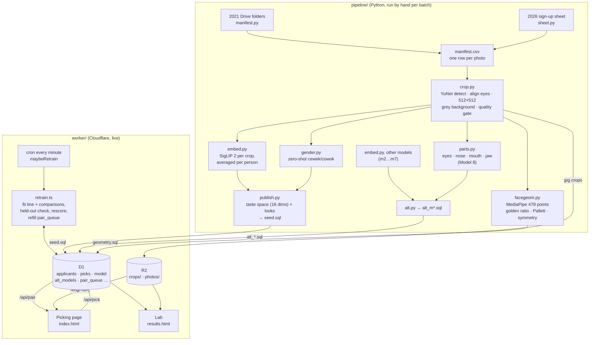
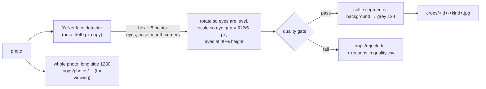
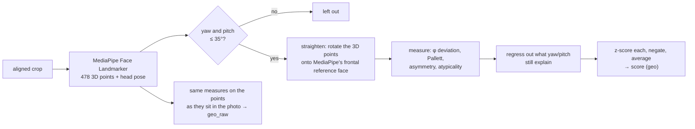
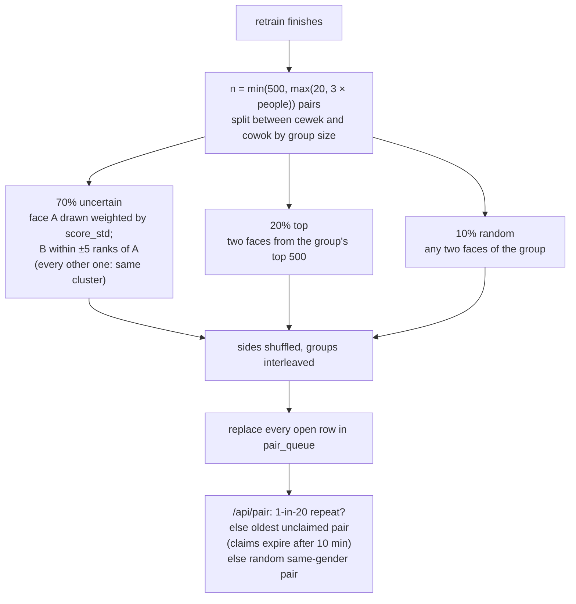

# The pipeline, end to end

How a sign-up photo becomes a score on the Lab page: every step, what the
code does, the numbers it uses, and why. It is written from the code as of
2026-10-27; file and function names are given so you can check.

Background and decisions are in [context.md](./context.md), commands in
[howto.md](./howto.md). This page explains *how it works*; it does not repeat
the decisions table or the command recipes.

- [Overview](#overview)
- [1. Data in](#1-data-in)
- [2. Faces: detect, align, crop, gate](#2-faces-detect-align-crop-gate)
- [3. Embeddings](#3-embeddings)
- [4. Taste space and looks](#4-taste-space-and-looks)
- [5. Gender](#5-gender)
- [6. Face geometry (golden ratio)](#6-face-geometry-golden-ratio)
- [7. Face parts (Model 8)](#7-face-parts-model-8)
- [8. Picks](#8-picks)
- [9. Scoring: the straight line](#9-scoring-the-straight-line)
- [10. Choosing the next battles](#10-choosing-the-next-battles)
- [11. Comparison models](#11-comparison-models)
- [12. Retraining and the held-out check](#12-retraining-and-the-held-out-check)
- [13. The Lab (results page)](#13-the-lab-results-page)
- [14. Storage: D1 and R2](#14-storage-d1-and-r2)
- [15. Planned comparison at ~1,000 picks](#15-planned-comparison-at-1000-picks)
- [Glossary](#glossary)

## Overview

Two halves. The **pipeline** (`pipeline/`, Python) runs once per batch of
applicants on a laptop or cloud session: photos in, SQL and images out. The
**Worker** (`worker/`, TypeScript on Cloudflare) runs all the time: it serves
battles, stores picks, and retrains the scores every few minutes.



Throughout, people are known only by `applicant_id`. No name, phone, email,
address, NIK or social handle is read past the first step, and none of them
reach D1, R2, the repo or logs.

## 1. Data in

Two sources are loaded today, into one shared pool of **840 people** (189
from 2021, 651 from 2026).

### 2021: "Hasil Screening COI 2021" (Google Drive)

`pipeline/sinemart/manifest.py`

- The Drive has one folder per applicant (`<id> - <NAME>/`) under stage
  folders such as `01- Lolos SELEKSI TAHAP AWAL`. Only ~170 round-1 passers
  are there, not the ~17k sign-ups.
- We list it with `rclone lsjson` and parse the file names
  (`<id>-Foto-Closeup-…jpg`, `<id>-Foto-Fullbody1-…jpg`). Renamed uploads fall
  back to the id in the folder name; videos and decks are ignored.
- `applicant_id` = Sinemart's own applicant number (up to ~17k).
- **Duplicates**: the same photo often sits in two stage folders, or was
  re-uploaded as `…(1).jpg`. `build_manifest` keeps **one photo per
  applicant per kind** (closeup, fullbody1, fullbody2…).
- Photo order per person (`photo_rank`): closeup first, then full-body 1, 2…,
  then anything else. The first usable face becomes the face raters see.
- Result: 189 people with at least one usable face.

### 2026: "SINEMART MENCARI BINTANG 2026! [RAW & SORTIR]" (Google Form sheet)

`pipeline/sinemart/sheet.py`

- Sheet RAW has every sign-up (~1,050 rows), sheet SORTIR the team's own
  shortlist (~123). The sheet id is deliberately not in the repo.
- The code reads **only** the column "Foto profile (GRID)" (a Drive link per
  person, a file or a folder). For a folder it takes the first 6 files.
  Downloads that aren't images (private links, videos, error pages) are
  dropped.
- `applicant_id` = `260000 + RAW row` (`ID_BASE`), so 2026 ids can never
  collide with 2021 numbers. A new source must get its own `ID_BASE`.
- SORTIR membership is matched by timestamp or email *inside the script
  only* and written as `labels.csv` (`applicant_id, shortlisted`). Emails are
  never written out. That label goes into `outside_labels` and is used only
  as an aggregate check (section 13); raters never see it.
- The form asks for a photo **grid** (several shots of one person in one
  image), so 2026 photos are cropped with `--grid` (section 2).
- Result: 651 people with at least one usable face.

### "bc" test batch (2026-10-27)

394 photos from an Instagram showcase account (one girl per post, carousel
photos `_1`, `_2`…), R2 bucket `talent-applicant`, prefix `bc/` (expandra
account), copied to `sinemart-talent/bc/`. One applicant per post, ids
`900000 + post number` (by date), `stage = 'bc'`. Cropped without `--grid`;
201 of 259 posts have a usable face (three crops of the account's cartoon
logo were dropped by hand). They are a **model test only**: projected into
the live taste space with `sinemart.project` (not re-published) and marked
`noise = 'bc'`, so they never enter battles, training or leaderboards.

### Noise and duplicates

Nothing is deleted. A bad person is marked in `applicants.noise` (the
marker's name, or `'duplicate'`), which takes them out of battles, training
and leaderboards while keeping their picks; clearing it restores them.

- **Exact duplicate sign-ups** (2026-10-22): 15 people who signed up twice
  with the same photos had identical embeddings and were marked
  `noise = 'duplicate'`.
- **Near duplicates** (2026-10-27): a face-match scan found 6 groups and 15
  more extra sign-ups (one man signed up 11 times). Not marked yet; waiting
  for Muajir's OK (see context.md, open items).
- **Bad photos** found while picking ("Foto bermasalah" → "Bukan foto wajah /
  orang lain") are marked with the rater's name. 16 people are marked noise
  in total as of 2026-10-27.

### KTP photo removal

Besides face crops, the app can show each person's **whole photos** (table
`photos`, swipe ‹ › on the picking page). For 2026 those were the uploaded
"other photos", and some turned out to be KTP cards (NIK, address) and
Instagram screenshots.

On 2026-10-22, with Muajir's approval, **all 939 whole-photo rows for 2026
were deleted from `photos`**. 2026 people are judged by face crop only. The
face crops themselves are tight, aligned faces and don't carry document
text. The R2 objects under `photos/` still exist but nothing points at them.
Rule from then on: never load whole photos without filtering out documents
and screenshots first; when in doubt upload crops only.

Gotcha: `publish.py` starts `seed.sql` with `DELETE FROM photos` and writes a
row for every whole photo in `quality.csv` (`view = 1`). Re-publishing with
the 2026 `quality.csv` as it is would bring the KTP photos back. Drop those
rows (or skip the `photos` inserts for 2026) before re-publishing.

## 2. Faces: detect, align, crop, gate

`pipeline/sinemart/crop.py`. Every photo becomes a **512×512 headshot with
the eyes level, at the same height and the same distance apart, on flat
grey**. The models then compare faces, not bedrooms, lighting setups or
phone lenses.



**Detect.** OpenCV YuNet (`cv2.FaceDetectorYN`) gives a box, five landmarks
(both eyes, nose, both mouth corners) and a confidence. Faces are sorted
largest first; the largest is the person.

**Align** (`align_matrix`). One similarity transform: rotate by the angle of
the eye line, scale so the crop side is `SIDE_IOD = 5` inter-ocular
distances, and place the eye midpoint at the horizontal centre and
`EYE_Y = 40%` down. Output is 512×512; areas outside the photo fill with grey.

**Quality gate** (`assess`). A crop is rejected, with the reason recorded, if:

| Reason | Rule |
|---|---|
| `no_face` | detector found nothing |
| `low_face_score` | detector confidence < 0.8 |
| `face_too_small` | eyes < 30 px apart in the original (face ~75 px wide) |
| `blurry` | Laplacian variance of the central face area < 15 |
| `bad_exposure` | mean brightness of the face area outside 50–210 |
| `not_frontal` | nose more than 0.30 eye-gaps off the eye midpoint (a yaw proxy) |
| `multiple_faces` | a second face larger than 30% of the main one (group photo) |

**Grey background.** With the MediaPipe selfie segmenter installed, the
person mask (slightly blurred) composites the face onto grey 128
(`bg = grey` in `quality.csv`).

**Grids (2026, `--grid`).** Every face larger than 30% of the biggest becomes
its own crop (`<id>-photo0.jpg`, `<id>-photo0f2.jpg`, …), each gated on its
own; the "several faces" rule is switched off. Small background faces are
ignored.

**Outputs.** `crops/<id>-<kind>.jpg` (passing crops), `crops/rejected/`,
`crops/photos/` (whole photos resized for viewing) and `crops/quality.csv`
(one row per crop with every measurement). A person is loaded only if at
least one crop passes.

## 3. Embeddings

`pipeline/sinemart/embed.py`. Each passing crop goes through a **frozen**
image model (no fine-tuning); the output vector is L2-normalised.

**Averaged per person** (`per_person`): all of a person's crop vectors are
summed and re-normalised to unit length. One odd photo then moves the
person's position less, and people with a 2026 grid of 4–6 faces get a
steadier vector.

Model 1, the one that ranks, is **SigLIP 2 base**
(`google/siglip2-base-patch16-224`, 768 numbers). The `MODELS` dict also
holds the comparison models (section 11). ArcFace is the odd one out: it
expects its own 112×112 face template, so `ARCFACE_BOX` cuts the matching
region out of our 512 px crop (same eye spacing and height as its template).

Output: an `.npz` with `ids`, `emb` (one unit vector per person),
`n_photos` and the model name.

## 4. Taste space and looks

`pipeline/sinemart/publish.py` (`taste_space`) and `bt.py` (`Looks`,
`HillsHead._init`).

768 numbers per person is more than a few hundred picks can learn. So the
pipeline precomputes a small **taste space**:

1. **PCA.** Centre all people's vectors and keep the top **16** principal
   directions, each scaled to unit spread (whitened). A person's `z` is their
   16 coordinates. The space is shared by cewek and cowok and centred, so
   `z = 0` is the average applicant.
2. **Looks** (clusters). k-means++ on the full embeddings, **separately per
   gender**, with `k = min(12, n/3)`. Each person gets a `look`; the look
   centres, projected into taste space, become the starting **peaks** of the
   hills model (stored in `model.init` with each peak's gender). Looks are
   found from the faces alone; no ethnicity or other label is used.

`publish.py` writes `seed.sql`: one `applicants` row per person (main crop's
R2 key, stage, look, `z`, gender), one `photos` row per viewable whole photo,
and `model.init`. Gotchas:

- Adding people means re-publishing **everyone** so all share one taste
  space. People not in the new load are deleted from `applicants` (their
  picks stay in `picks`).
- A gender fixed by hand (`gender_src = 'manual'`) survives a re-publish.
- Re-publishing clears scores and `rater_models`; the next retrain refits
  from the stored picks.

## 5. Gender

`pipeline/sinemart/gender.py`. Neither source has a gender column, so it is
guessed **zero-shot** with SigLIP 2's text side:

- Each crop is compared with three prompts per class ("a photo of a woman /
  young woman / girl" vs "… man / young man / boy"). The best-matching prompt
  of each class counts, and a softmax at scale 100 gives `p_female`.
- A person's `p_female` is the mean over their crops; ≥ 0.5 = cewek (`f`),
  else cowok (`m`). Between 0.2 and 0.8 is reported as "unsure" to check.
- Stored with `gender_src = 'auto'`.

**Manual fixes.** Lab → "wrong? move to …", or picking page → "Foto
bermasalah" → "Bukan cewek/cowok". Both call `POST /api/gender`, which sets
`gender_src = 'manual'`, drops all cached per-rater models and sets
`model.n_picks = 0` so the next cron run retrains.

What gender does: it **groups** people. Battles are same-gender only,
leaderboards and looks are per gender, and scores are compared only within a
gender. It is never an input to the score. Picks made across genders before a
fix are ignored in training.

The 2026-10-27 audit found the auto guess's misses concentrated on one
person who signed up 11 times; black-and-white photos were otherwise fine.

## 6. Face geometry (golden ratio)

`pipeline/sinemart/facegeom.py`. A **fixed rule**, never trained, kept as a
comparison: "do classic proportion rules agree with the team?"



**Landmarks.** MediaPipe Face Landmarker gives 478 3D points (468 mesh + 10
iris) and the head's transformation matrix, from which yaw and pitch are
read. Faces turned more than `MAX_POSE_DEG = 35°` are dropped: the hidden
side is guessed, not seen.

**Straighten** (`straighten`). A turned head makes every ratio, and above all
symmetry, look worse. The 3D points are rotated (SVD/Kabsch) onto
MediaPipe's own frontal reference face, which the code reads out of the
`.task` bundle (`canonical_mesh`). Depth from one photo is approximate;
`DEPTH_SCALE = 1.07` was tuned so turned and frontal faces come out alike.
Then `pose_corrected` regresses each measure on yaw, pitch, their squares
and product across all crops and removes that part. Before this, symmetry
was 0.98 correlated with head turn.

**The four measures** (lower = closer to the ideal):

| Measure | What it is |
|---|---|
| `phi_dev` | mean \|log(ratio / 1.618)\| over five "golden" proportions: face length/width, mouth width/nose width, nose-tip-to-chin / lips-to-chin, outer-eye width / mouth width, pupils-to-chin / pupils-to-top |
| `pallett_dev` | distance from Pallett, Link & Lee (2010): eyes-to-mouth = 36% of face length, pupil distance = 46% of face width |
| `asymmetry` | mean gap between each mesh point and its mirror partner after Procrustes alignment, in pupil distances |
| `atypicality` | Procrustes distance from the average face of the same gender (averageness, reversed) |

Mesh point 10 (the top of the mesh) stands in for the hairline, which
MediaPipe doesn't have, so "face length" runs to the top of the forehead.
That offsets the length ratios a little.

**Score.** Per person, each measure is averaged over their crops, z-scored
across everyone, negated and the four averaged: higher = closer to every
ideal. Two fixed models are written:

- `geo`, "Golden ratio · straightened" (the main one).
- `geo_raw`, "Golden ratio · original": the same measures on the raw photo
  points, no straightening or correction (correlation ~0.43 with `geo`).

Tables: `geometry` (the four measures and score per person) and
`face_points` (15 key points per crop, raw and straightened, plus yaw and
pitch) so the pages can draw the lines. On the picking page the golden-ratio
numbers and lines are toggles, **off by default**, so raters aren't steered.
The straightened (warped) face *photos* were tried and removed at Muajir's
request; only the numbers use straightening.

## 7. Face parts (Model 8)

`pipeline/sinemart/parts.py`. The other models see the whole face at once;
Model 8 asks "which features does the team react to?"

1. MediaPipe landmarks on each crop place **four boxes**, sized from the
   face's own proportions (`boxes`):
   - **eyes**: both eyes and brows (eye width ×1.3 wide, from ~0.45 eye
     widths above the pupils);
   - **nose**: nose bridge to just below the tip, 1.8 nostril widths wide;
   - **mouth**: 1.5 mouth widths wide, 0.8 high;
   - **jaw**: cheek to cheek, from just above the mouth to below the chin.

   Hair and forehead are left out on purpose.
2. Each box is padded onto a grey square (no stretching) and embedded with
   SigLIP 2 base, the same model as Model 1.
3. Each part is averaged per person, then the four 768-number vectors are
   joined into **3,072 numbers** (divided by 2 so it stays unit length).
4. `alt.py` loads it as key `m8` like any other comparison model.

Like every model, it is cut to its own 16-dimension taste space, and the
16 directions mix the parts. So the app does not report "eyes matter X%";
that would need a separate fit per part.

## 8. Picks

The picking page (`worker/public/index.html`) shows two faces of the same
gender with the question **"Mana yang lebih menarik?"** Under each face:
"Pilih yang ini", ‹ › to flip through whole photos (2021 only now), and
"Foto bermasalah". Below: "↶ Batalkan", "Sama saja", "Keduanya kurang
menarik", "Lewati". Keyboard: `1`/`2` pick left/right, `t` or `=` tie, `n` or
`0` neither, `s` or space skip, `u` or Backspace undo, ←/→ flip photos.

Sign-in is a name only (`POST /api/login`); the same name in any case is the
same rater on any device.

Every answer is one row in `picks`:

| Answer | Stored as | How training uses it |
|---|---|---|
| Pilih yang ini | `winner_id` = that face | a win (y = 1) |
| Sama saja (tie) | `tie = 1`, `winner_id` NULL | half a win each way (y = 0.5): pulls the two scores together |
| Keduanya kurang menarik (neither) | `neither = 1`, `winner_id` NULL | both faces fall below their gender's "no" line (section 9); not a tie |
| Lewati (skip) | all three empty | **not trained**; it means "can't judge" (bad photo, someone they know) |
| ↶ Batalkan (undo) | the rater's last row from the past 30 minutes is **deleted** and the pair is shown again | |

`picks.kind` records where the pair came from: the queue kind (`uncertain`,
`same_hill`, `top`, `random`), `repeat`, or `fallback` (a random pair served
when the queue was empty, or a queued pair cleared by a retrain while on
screen). `ms` is the time taken to answer.

**Repeats.** On each pair request there is a 1 in 20 chance (`REPEAT_EVERY`)
of re-asking a pair this rater already decided with a winner, at least 20
picks ago, never repeated before, with **sides swapped**. Those rows have
`kind = 'repeat'` and are **left out of training**. They measure how often a
rater agrees with themselves: the ceiling no model can beat.

**Counting decided picks.** A pick is *decided* if it has a winner, a tie or
a neither (`ANSWERED` in `retrain.ts`). Most rows in `picks` are skips, so
always quote decided picks, never raw rows. What the model actually trains
on is narrower still: decided, not a repeat, both people scored, same gender
and neither marked noise. That is the number `maybeRetrain` counts and
`model.n_picks` stores, so the Lab's "trained on N picks" can be lower than
the decided count.

## 9. Scoring: the straight line

`worker/src/hills.ts`, class `Arrow`. This is **Model 1**: it produces every
score on the leaderboard and picks the battles (decided 2026-10-22, when it
won the held-out comparison).

It is a Bradley–Terry model on the taste space:

```
score(person) = w · z(person)                       (16 weights, no intercept)
P(a beats b)  = sigmoid(score(a) − score(b))
```

Fitting (`Arrow.fit`): 300 steps of Adam (learning rate 0.05) on the
cross-entropy of every training pick against its target (1 for a win, 0.5
for a tie), with a small L2 penalty (0.01) on `w`. All raters' picks go into
one model.

**"Neither" picks** teach a per-gender **"no" line** `tau[g]`. A "neither"
answer is read as both faces losing to an imaginary opponent sitting on the
line: P(face below the line) = sigmoid(tau[g] − score). Only faces *below*
the line are ever labelled, so nothing would stop `tau` drifting up; a pull
towards 0 (`TAU_PULL = 0.1`, and 0 is the average face) keeps "clear no"
meaning "well below average". Only the straight line learns from "neither";
the hills ignore it.

One `w` serves both genders, but scores are only ever compared within a
gender (battles, leaderboards, and the per-gender centring below).

**Uncertainty** (`score_std`): three bootstrap fits (picks resampled with
replacement, 150 steps each), each centred within its gender; the spread of
a person's three scores is their `score_std`. It drives battle choice
(section 10) and the Lab's "Certainty" label.

**Clusters for display.** The hills model (section 11) is fitted on all
picks in the same retrain; each person's `look` is the hill they stand on.
It names the "cluster" on the Lab and is used to make same-cluster battles,
but does not change the score.

## 10. Choosing the next battles

`hills.ts` `groupedPairs` and `nextPairs`, called at the end of each
retrain; served by `nextPair` in `index.ts`.



- **Uncertain** pairs are the informative ones: a face whose score is still
  unsettled against a neighbour of similar score. Half of them stay within
  one cluster ("same_hill") to pin down order inside each look; the other
  half are neighbours in the whole gender's ranking.
- **Top** pairs sharpen the order at the top, where the team will look.
  `topK = 500` is larger than the cowok group (248) and close to the cewek
  group (576), so at today's size "top" pairs are close to random within the
  group. Lowering `topK` would make them matter.
- **Random** pairs keep everyone in play.
- Each retrain **replaces** the whole open queue (including pairs on screen;
  their answers still count, as `fallback`). Noise people are removed from
  the queue when marked.
- When the queue is empty (cold start), `/api/pair` serves a random pair of
  the same gender.

## 11. Comparison models

They train on exactly the same picks and the same held-out split as Model 1,
but **never** drive battles or the default leaderboard. They exist to answer
"would something else do better?"

**Other shapes on Model 1's taste space** (`hills.ts`, `retrain.ts`):

- **Many clusters** ("hills"): beauty as a landscape with one hill per look.
  `z' = A z` (a learned 16×16 map, starting as identity), height on hill k
  `= −|z' − q_k|² / 2`, score = log-sum-exp over the person's own gender's
  hills (≈ the height of the hill they stand on). Peaks `q_k` start at the
  look centres and move with the picks; all peaks are equally tall, so the
  best face of any look can reach the top. Going past a peak scores lower
  again, unlike the line. 300 Adam steps, L2 pull of `A` towards identity.
- **One cluster**: the same with a single peak per gender, starting at the
  gender's average face.

**Other embeddings** (`alt_models`, `alt_z`). Each is embedded from the same
crops, given its own 16-dimension taste space and looks by `alt.py`, and
fitted three ways (line, many clusters, one cluster). People a model has no
vector for get their gender's average. The Lab shows them only as
"Model N", numbered by key order:

| Lab name | Key | Embedding | Notes |
|---|---|---|---|
| Model 1 | (main) | SigLIP 2 base, 768 | the ranker |
| Model 2 | `m2` | DINOv2 base | stand-in for DINOv3, which is gated |
| Model 3 | `m3` | FaRL (face CLIP, LAION-Face) | research / non-commercial weights |
| Model 4 | `m4` | ArcFace (InsightFace buffalo_l) | face *recognition*; non-commercial weights |
| Model 5 | `m5` | SigLIP 2 so400m | larger SigLIP 2 |
| Model 6 | `m6` | OpenAI CLIP ViT-L/14 | |
| Model 7 | `m7` | PE-Core-L-14-336 | |
| Model 8 | `m8` | face parts on SigLIP 2 base, 3,072 | section 7 |
| Golden ratio · straightened | `geo` | fixed rule | section 6 |
| Golden ratio · original | `geo_raw` | fixed rule | section 6 |

Fixed rules have no taste space: the retrain only scores their agreement
with the held-out picks (`heldout_fixed`); people without a measurement
count as average.

**Per-rater models** ("Taste of" on the Lab): the many-clusters model fitted
on one rater's picks alone (minimum 5), cached in `rater_models` and refitted
when that rater has new picks. It never touches the shared scores.

**Offline heads** (`pipeline/sinemart/bt.py`, `train.py`): Python versions
of the hills and line plus a look-centred line and a small MLP, with a
10-band win-rate check and a repeat ceiling, run on exported picks for
analysis. Its `update.sql` must not be applied to the live app.

## 12. Retraining and the held-out check

`worker/src/retrain.ts` `retrain`, triggered by `maybeRetrain` in
`index.ts`.

**When.** A cron runs every minute. It retrains when the trainable pick count
(section 8) is **10 or more above** `model.n_picks`, or when `n_picks` is 0
and there are at least 5 picks. Setting `model.n_picks = 0` forces a retrain
on the next run; gender fixes and noise restores do that automatically. The
Lab's "Retrain now" calls `POST /api/retrain` directly, and `/api/results`
retrains first if a model was reloaded and has no fit yet. Retraining used to
run inside the pick request and was cut off at ~30 s once there were 840
people × 8 models, which froze the scores; the cron allows up to 5 minutes
of CPU (`limits.cpu_ms`).

**What one retrain does, in order:**

1. Load `z`, gender and the trainable picks of every non-noise person.
2. **Held-out split.** With 30+ people, hold out a random **20% of people**
   (not picks): train on picks between two kept people, test on every pick
   that touches a held-out person. The real job is scoring faces the team
   never judged, so this is the honest test. The split is seeded by the pick
   count, so it is reproducible and moves as picks grow. ("Neither" answers
   about held-out people are left out of training too.)
3. Fit line, many clusters and one cluster on the training part; record each
   one's **held-out agreement**: the share of decisive held-out picks (ties
   and "neither" don't count) where the higher-scored face is the one the
   rater picked. 50% is a coin flip.
4. Refit everything on **all** picks; write `score`, `score_std` and `look`
   for everyone.
5. Make a fresh batch of battles and replace the open queue (section 10).
6. Store the fits (`model.params_line` with `w`, `tau` and the gender order;
   `params`, `params_one`) and the held-out numbers in `model`.
7. Repeat steps 3–4 for every comparison model on the same split
   (`fitAlternates`) and store theirs in `alt_models`.

**Reading the numbers.** The test set is a few hundred picks at most, so a
difference under ~5 points is noise. At 520 picks (174 held out) the line
scored 65% and m6 (CLIP L/14) 76%; the latest numbers are in context.md
("Where things stand") and live on the Lab. The rater self-agreement on
repeats is the ceiling to compare against.

## 13. The Lab (results page)

`worker/public/results.html`, data from `/api/results`, `/api/map`,
`/api/raters`, `/api/check`, `/api/battles/<id>`. Sign-in is the same name as
the picking page. The view (gender, model, rater, cluster, filters) is kept
in the URL.

- **Switches.** Cewek / Cowok; model (Model 1…8, golden ratio); shape
  (Straight line / Many clusters / One cluster); "Taste of" a single rater.
- **Model card.** Active model, decided picks with ties, neithers and skips,
  Model 1's held-out agreement, the repeat ceiling, and the held-out table
  for every model and shape. "Retrain now" and "Reset all scores" (the latter
  deletes every pick; never use it without Muajir asking).
- **Score shown** = 0–100: how often this person would beat an average
  applicant, `sigmoid(score − mean score)`. **Certainty** from `score_std`:
  high < 0.25, medium < 0.6, else low.
- **Top vs bottom.** The best and worst faces of the current list side by
  side, plus the **2026 screening check**: how many SORTIR-shortlisted
  people sit in their group's top 50 against what chance would give, and the
  chance a shortlisted person outranks a non-shortlisted one (AUC). Only
  these aggregates leave the API; raters never see who was shortlisted.
- **Territory map** (collapsed until opened; `map.ts`): faces and peaks
  projected onto the plane that best separates the peaks in the learned
  taste space, shaded by the model's height. A slice of a 16-dimension
  landscape, so distances are rough; scores are exact.
- **Rater agreement.** Per rater: how well the team model predicts their
  picks; how well each other rater's personal model does; plain agreement
  where two raters judged the same pair; and the repeat ceiling per rater.
- **Leaderboard.** Per gender, filter by cluster, "No battles yet (N)" for
  people never in a decided battle. Opening a face shows all photos, the
  golden-ratio overlay on request, the battle history (who they met, the
  result, who judged, skips included) and "wrong? move to …".
- **Marked as bad photos.** Everyone with `noise` set, with Restore.

All UI text says "model", "skor", "Model N": no technology names.

## 14. Storage: D1 and R2

Cloudflare account "Muhajir"; ids and bindings are in `worker/wrangler.toml`
and howto.md.

**R2** bucket `sinemart-talent` (binding `IMAGES`):

- `crops/<id>-<kind>.jpg`: aligned grey face crops (what battles show first).
- `photos/<id>-<kind>.jpg`: whole photos for viewing. Only 2021 rows remain
  in D1 `photos`; the 2026 objects are orphaned (section 1).

Images are served only through `/img/<id>` (main crop) and `/img/<id>/<n>`
(n-th whole photo) by the Worker, with `X-Robots-Tag: noindex` and private
caching. No bucket is public.

**D1** database `sinemart-talent` (binding `DB`). Fresh schema in
`worker/schema.sql`, dated changes for the live database in
`worker/migrate.sql`.

| Table | One row per | Written by | Holds |
|---|---|---|---|
| `applicants` | person | `publish.py`; retrain; gender/noise endpoints | crop key, stage, taste-space `z`, `look`, `score`, `score_std`, `gender`, `gender_src`, `noise` |
| `photos` | whole photo | `publish.py` | viewing order, kind, R2 key, whether its face counted |
| `raters` | rater | `/api/login` | token, name |
| `picks` | answer | `/api/pick`, `/api/undo` | rater, both ids, winner / tie / neither, kind, ms, time |
| `pair_queue` | queued battle | retrain; repeats | pair, kind, batch, who it was served to, when answered |
| `model` | (one row) | `publish.py` (`init`); retrain | look peaks, fitted line / hills / one-cluster, held-out numbers, `n_picks` trained on |
| `alt_models` | comparison model | `alt.py`, `facegeom.py`; retrain | init peaks, fits, held-out numbers, `fixed` scores for rules |
| `alt_z` | person × comparison model | `alt.py` | that model's taste-space `z` |
| `rater_models` | rater | `/api/results?rater=` | cached personal model |
| `geometry` | person | `facegeom.py` | the four measures and combined score |
| `face_points` | crop | `facegeom.py` | key points (raw and straightened), yaw, pitch |
| `outside_labels` | person × source | loaded by hand | e.g. `sortir2026`: 1 = on the 2026 shortlist; aggregates only |

The `applicants.score` comment in `schema.sql` still says "hills-model
score"; since 2026-10-22 it is the straight line's score (`model = 'line'`).

## 15. Planned comparison at ~1,000 picks

Decided 2026-10-22: the straight line stays the ranker until about **1,000
decided picks**. Then the held-out table is read again, and a switch is
proposed **only if another model beats the line by more than 5 points**
(below that it is noise at this test size). A weekly check starts
2026-10-29.

At the last snapshot (520 picks) Model 6 (CLIP L/14) was ~11 points ahead
and FaRL ~8. If that holds:

- Switching means making `retrain()` rank and choose battles with that
  model's line (`alt_models.params_line` on `alt_z`) instead of Model 1's.
  That is Muajir's call.
- FaRL and ArcFace weights are non-commercial; CLIP L/14 is not restricted in
  the same way, but check licences before anything beyond the prototype.
- Also worth reading at that point: Model 8 per part, hills vs line again,
  and the repeat ceiling (if the team agrees with itself only ~75%, no model
  can do much better).

## Glossary

| Word | Meaning |
|---|---|
| Crop | a 512×512 aligned grey face image from one photo |
| Embedding | the vector a frozen image model gives a crop; per person, the average |
| Taste space | 16 whitened principal directions of the embeddings; each person's `z` |
| Look / cluster / hill | a k-means group of similar faces within one gender |
| Straight line / Arrow | Model 1's ranker, score = `w · z` |
| Decided pick | winner, tie or neither (not a skip) |
| Held-out agreement | share of decisive picks about unseen people the model orders right |
| Repeat | a pair re-asked of the same rater with sides swapped, not trained, used for the ceiling |
| Noise | `applicants.noise` set: left out everywhere, reversible |
